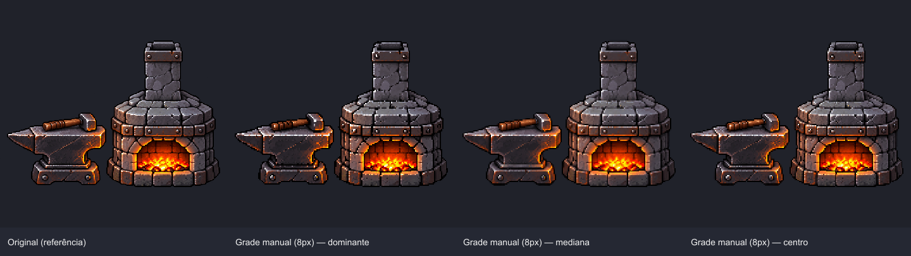
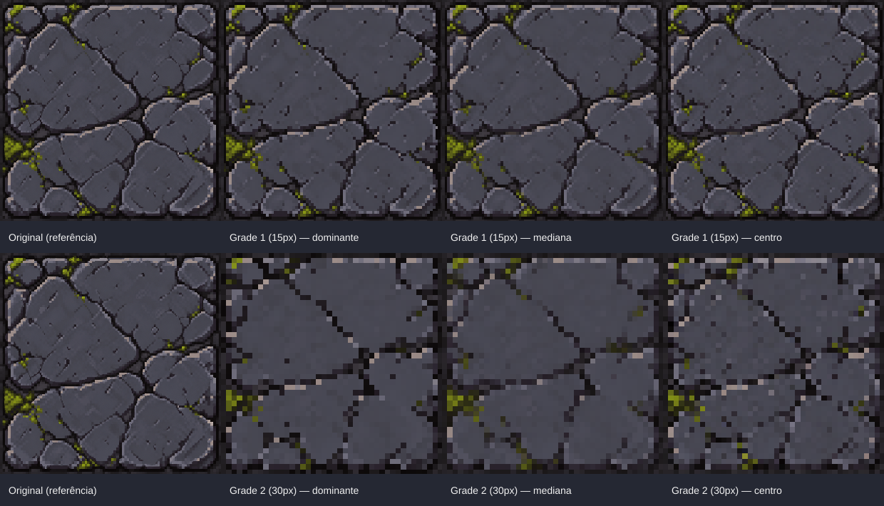

# Pixel Normalizer

A TypeScript command-line tool that estimates the logical pixel grid in AI-generated pixel art and replaces each grid cell with a representative color. It preserves the source image dimensions and creates three visual variants for each selected grid.

[Leia este guia em português](LEIA-ME.md).

## Examples

These are the `comparativo.png` files the tool generates, so their labels are in Portuguese.



With `--cell 8`, you get the original followed by the three color strategies for that grid.



In automatic mode, you can compare candidate grids. Here, the 15 px grid keeps the detail, while the 30 px grid is too coarse.

## Requirements

- [Node.js](https://nodejs.org/) 22.18 or newer, which runs TypeScript directly with no build step
- Sharp, installed from the project dependencies

Install the dependencies from the project directory:

```sh
npm install
```

## Quick start

Put an image in `input/`, then pass its path relative to that folder:

```sh
node pixel-normalizer.ts "my-image.png"
```

To process every supported image directly inside `input/`, omit the image name. Files are processed in the order returned by the directory listing; subdirectories are skipped. The supported extensions are `.png`, `.jpg`, `.jpeg`, `.gif`, `.bmp`, `.tif`, `.tiff`, `.ico`, `.webp`, `.avif`, `.heic`, and `.heif` (case-insensitive).

```sh
node pixel-normalizer.ts --cell 8
```

Each image gets its own output folder in that order: `normalized-output`, `normalized-output-2`, and so on. Options such as `--cell`, `--grids`, and `--preview` apply to every image in the batch. If no supported image is found directly inside `input/`, the command reports an error.

Subdirectories are supported as long as the image stays inside `input/`:

```sh
node pixel-normalizer.ts "characters/hero.png"
```

The image must be at least 16 by 16 pixels.

## Output

Results are written under `output/`. By default, the output folder is `output/normalized-output`. Use `--out` to choose another relative path inside `output/`:

```sh
node pixel-normalizer.ts "my-image.png" --out "forge"
```

If the requested output folder already exists, the program chooses a numbered folder to avoid replacing it. It uses the next number after the highest existing numeric suffix; for example, if `output/forge-5/` exists, the next run uses `output/forge-6/`.

In batch mode, the same rule is applied once per image, preserving the input listing order. With `--out "forge"`, the folders are named `forge`, `forge-2`, and so on when those names are available. `--overwrite` is rejected in batch mode.

To clear and recreate the exact requested output folder, use `--overwrite` or `-o`:

```sh
node pixel-normalizer.ts "my-image.png" --out "forge" --overwrite
node pixel-normalizer.ts "my-image.png" --out "forge" -o
```

`--overwrite` removes the contents of that exact output folder before writing new results.

Each output folder contains:

- `comparativo.png`: the original image and generated variants, arranged for visual comparison.
- `grade-<number>-<size>px-dominante.png`: each cell uses the average color of its most frequent color cluster.
- `grade-<number>-<size>px-mediana.png`: each cell uses the per-channel median color.
- `grade-<number>-<size>px-centro.png`: each cell uses the color of its center pixel.
- `report.json`: input dimensions, grid sizes, offsets, heuristic scores, and generated variant paths.

For example, a result can be named `grade-1-8px-dominante.png`. In automatic mode, the default is two selected grids, producing six variants. Set `--grids` to request from one to five grids. Manual mode with `--cell` produces one grid and its three variants.

## Command options

```text
node pixel-normalizer.ts [<image>] [options]
```

The image argument is optional. Without it, the command processes supported image files directly in `input/`.

| Option | Default | Description |
| --- | --- | --- |
| `--out <folder>` | `normalized-output` | Output path relative to `output/`. |
| `-o`, `--overwrite` | off | Clear and recreate the exact output folder for one image; unavailable in batch mode. |
| `--min-cell <n>` | `3` | Smallest logical cell size considered during automatic detection. |
| `--max-cell <n>` | `128` | Largest logical cell size considered during automatic detection. |
| `--cell <n>` | automatic | Set a cell size manually; the program still estimates horizontal and vertical offsets. |
| `--grids <n>` | `2` | Number of alternative grids to produce in automatic mode, capped at five. |
| `--preview <n>` | `360` | Width in pixels for each preview thumbnail. The effective width is limited to 100–600 pixels. |
| `--help`, `-h` | — | Print the command help. |

Cell-size values, grid counts, and preview width must be positive integers. `--cell` accepts a positive safe integer and may be larger than the image dimensions. Automatic detection requires `--min-cell` to be less than or equal to `--max-cell`; its upper bound is also limited to one fifth of the shorter image dimension so that candidate grids have room to repeat.

Examples:

```sh
# Choose a cell size manually
node pixel-normalizer.ts "my-image.png" --cell 8

# Process every supported image directly in input/
node pixel-normalizer.ts --cell 8

# Search a wider automatic range and produce three grids
node pixel-normalizer.ts "my-image.png" --min-cell 2 --max-cell 160 --grids 3

# Make wider thumbnails
node pixel-normalizer.ts "my-image.png" --preview 480

# Print all CLI options
node pixel-normalizer.ts --help
```

## How it works

1. The program measures color and alpha changes between neighboring pixels to build horizontal and vertical edge profiles.
2. In automatic mode, it scores candidate cell sizes and grid offsets against those profiles, then selects distinct high-scoring grid sizes.
3. For each selected cell, it computes a representative color using the dominant cluster, per-channel median, or center pixel strategy.
4. It fills each cell with that color without interpolation. Partial cells along image edges are kept, and the output retains the original dimensions.

Grid detection and scores are heuristic. Images without a consistent global grid, or with different logical pixel sizes in different regions, may not have one result that fits every detail. Compare the alternatives in `comparativo.png`.

## Technology

- TypeScript running directly on Node.js
- Sharp for image decoding and PNG output
- No Python, OpenCV, or external AI service is required
